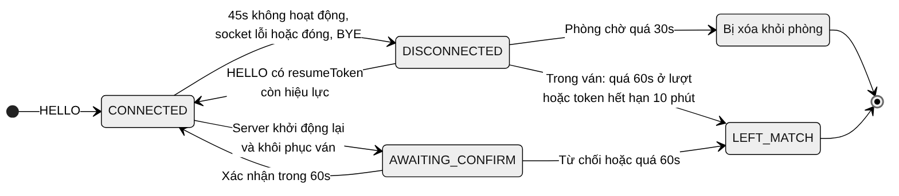
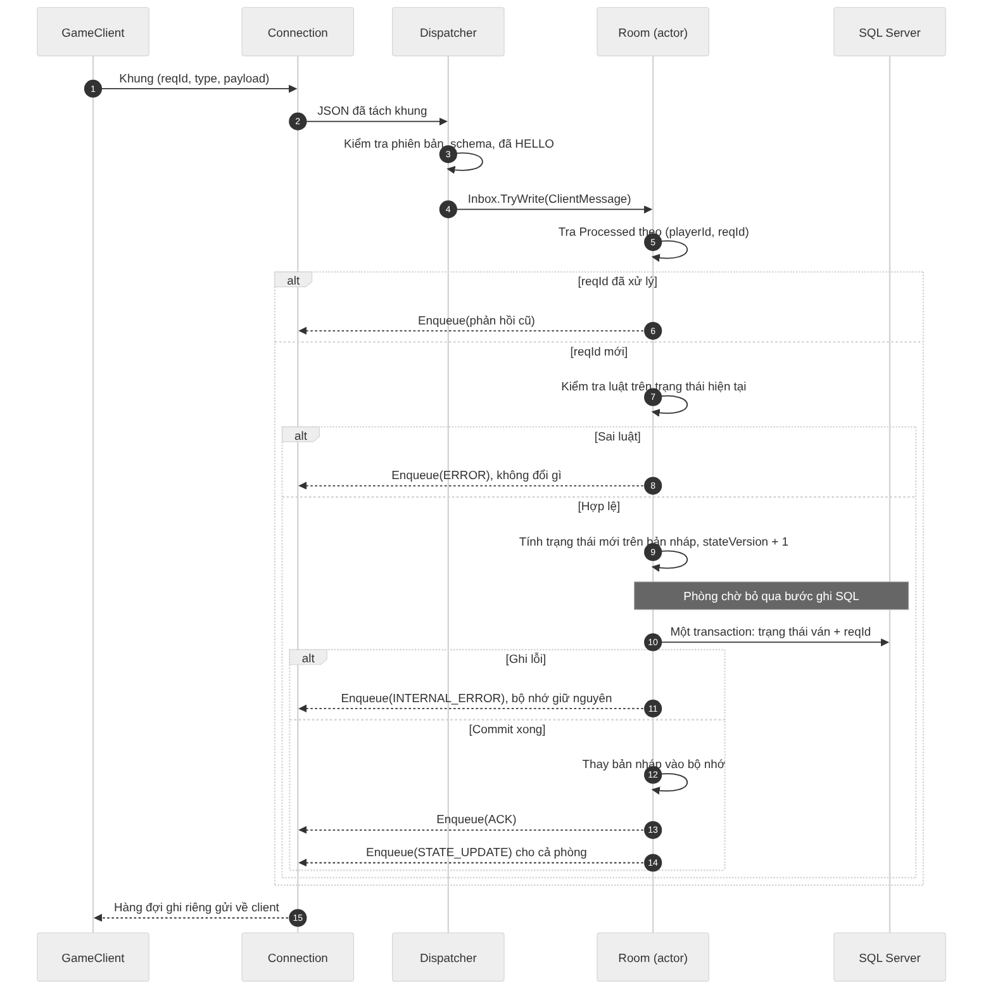
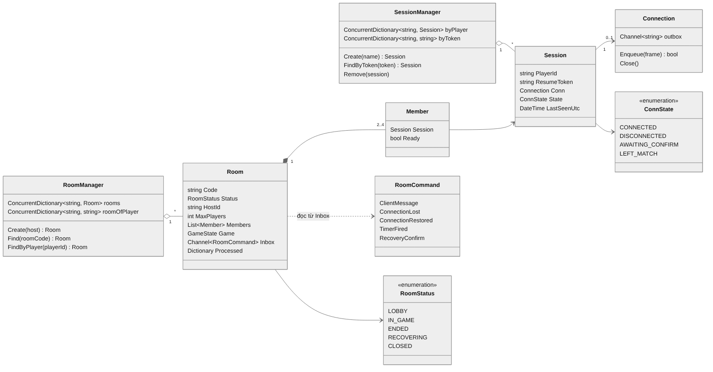

# Sơ đồ thiết kế

Nguồn: `docs/kien-truc-client-server.docx` (Lê Anh Tuấn).

| Ảnh | Nội dung | Mục trong tài liệu |
|---|---|---|
| `kien-truc-client-server.png` | Kiến trúc Client–Server, 1 hàng đợi mỗi phòng | 2 |
| `vong-doi-phong.png` | Vòng đời phòng (LOBBY, IN_GAME, ENDED, RECOVERING, CLOSED) | 3 |
| `trang-thai-ket-noi.png` | Trạng thái kết nối người chơi | 4 |
| `so-do-lop-server.png` | Lớp phía server (RoomManager, SessionManager, Session, Room...) | 5 |
| `xu-ly-hanh-dong.png` | Thứ tự xử lý một hành động hợp lệ | 5.2 |

File nguồn Mermaid nằm trong `src/` (`.mmd`). Sửa file `.mmd` rồi render lại:

```bash
mmdc -i src/trang-thai-ket-noi.mmd -o trang-thai-ket-noi.png -b white -s 2
```




